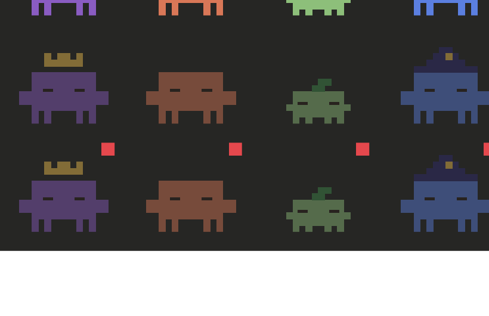

# Critters

A Claude Code mod (a plugin of function hooks) that shows your background agents as little pixel critters, just above the prompt.



Each model gets its own sprite:

- **Opus**: purple, with a gold crown
- **Sonnet**: the classic orange Claude critter
- **Haiku**: small and green, with a leaf
- **Fable**: blue, in a wizard's hat
- Anything else (or an agent that started before the mod loaded) is grey

While an agent works, its critter bobs and blinks. When it finishes it closes its eyes and dims; if it failed it gets a small red dot. Finished critters leave after two minutes. With reduced motion turned on, they stay still.

## Using it

- **The strip**: one thin row of sprites above the input, with a `3 running ▾` button on the right. Nothing is drawn when no agents are around.
- **Expand**: press `3 running ▾` for a list like the running-tasks view: each agent's title, model, status, time and tool count. `Less ▴` closes it again.
- **Transcript**: in the expanded list, press an agent's title to open its transcript in a pane (its prompt, what it said and each tool call). It updates as the agent works. Escape closes it.
- **Hide**: press `Hide` and the strip goes away; a plain `3 agents` button sits in the footer by the model selector instead. Press it to bring the strip back. This is remembered across sessions.
- `/critters` does the same as Hide and back.

## Install

```bash
claude plugin marketplace add ErnestTramp/claude-critters
claude plugin install critters@claude-critters
```

Or try it from a clone without installing: `claude --plugin-dir ./claude-critters`.

Needs Claude Code 2.1.287 or newer (the mods feature).

## How it works

- When an agent starts, the mod reads which model it was given and remembers it. That is why an agent started before the mod loaded shows up grey.
- Every ten seconds it checks Claude Code's own list of agents, to catch ones that were stopped and to clear away finished critters.
- The transcript comes from Claude Code's own record of that agent's conversation. Nothing is sent anywhere and nothing is written to disk except the hide setting, in the plugin's own store.
- The sprites are drawn as SVG. On the desktop app that is pixel art; in the terminal each critter is a single letter.

Built and used in the desktop app's Code tab. The terminal works but I have tested it less.

On the desktop only buttons can be clicked, not pictures, which is why expanding is a button next to the critters and not a click on a critter.

If another mod also draws in the footer and doesn't pass the slot on, the hidden `3 agents` button may not appear next to it.

The mods API is new and can change between Claude Code releases, so a future update may need a fix here.

## Develop

```bash
claude plugin validate .
claude plugin test .
```

Sprites live in `hooks/sprites.ts` as small text grids, one letter per pixel, so they are easy to redraw or add to.

## Licence

MIT
